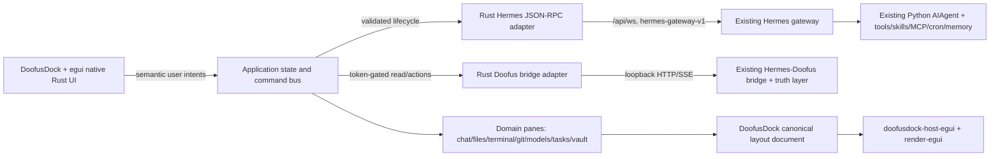

# Architecture: Rust shell, existing Hermes execution



## Canonical data ownership table (non-negotiable)
- Hermes gateway owns chats, session IDs, turn state, tool execution, model switching, profile scope, approvals, skills, subagents, cron and conversational memory.
- Doofus Python bridge owns task identities, plans, requirements, evidence, truth verification, intervention events, vault and model routing decisions.
- DoofusDock `LayoutDocument` owns only workspaces, panel IDs, placement, splits/tabs/floating geometry and persistent UI composition. Dock operation service is the **only** mutator of layout.
- Rust application holds **transient** derived UI state (drafts, filters, selection, scroll offsets, hide/peek state, focused input, RPC pending map, connection quality). Store only bounded UI preferences in a separate versioned file; avoid shadow session/secret databases.
- Terminal child process/remote host owns the terminal session. Hiding its pane must not release the shell; explicit Close may release it only when policy allows.

## Rust crate boundaries (proposed)
```
apps/hermes-doofusdock/                 # new Rust app; do not move Dock internals
  Cargo.toml
  src/main.rs                          # startup, single-instance, OS lifecycle
  src/app.rs                           # event loop and composition registry
  src/domain/                         # typed UI view-models; pure reducers
  src/transport/                       # discovery, WS JSON-RPC, replay, auth
  src/doofus/                          # typed bridge clients, SSE cursor + snapshot
  src/ui/widgets/                      # egui widgets NOT supplied by DoofusDock
  src/ui/panes/                        # registered application panes
  src/ui/navigation/                   # routes, palette, menus, shortcuts
  src/ui/theme/                        # URNE skin tokens; accessible fallback
  src/platform/windows/                # notifications, tray, focus, DPI, terminal
  tests/fixtures/                     # sanitized captured real protocol frames
  tests/parity/                        # source-target acceptance receipts
```

### Ownership invariants
1. DoofusDock core is a dependency, not a fork for chat logic; no API calls inside its pure core.
2. UI reducers consume typed envelopes and are testable without network or egui.
3. All server→client gateway requests must be answered or fail closed, with original JSON-RPC IDs and proper request-scoped permissions. No approval timeout disguised as a user denial.
4. Every retry carries a new transport attachment but never emits a second prompt submission without a documented durable admission guarantee.
5. Per-profile/gateway/session is part of each UI query key, cached record and command action; stale responses cannot write to the newly selected profile.
6. UI plugin compatibility is **not automatic**. The Hermes SDK is JavaScript/React and DoofusDock providers are Rust. Rewrite required Doofus surfaces as Rust panes and explicitly decide whether third-party JS plugin compatibility uses a sandboxed webview or remains a visible unsupported gap.
7. Sealed secrets stay in existing authority; UI receives minimum redacted metadata. No auto-unlock, no logging secret values.
8. No user- or agent-visible action is considered complete until gateway/bridge acknowledges it or source evidence confirms it.

## Gateway transport contract
Use `hermes gateway attach --json` (bounded start/recover) or documented local control socket. Attach output supplies WebSocket URL and one-time protocols. Negotiate `runtime.describe` before `session.create`, then `client.capabilities` after `gateway.ready` to announce supported server requests. See `maps/PROTOCOL_SURFACES.json` for documented methods. Verify full schemas from current upstream `tui_gateway` before writing data structures.

### Receiving a stream
`message.delta`, `message.complete`, `tool.start`, `tool.generating`, `tool.complete`, `gateway.ready`, `request.cancel`, lifecycle/errors; process in order through reducer; key UI rows by stable source identity. Use `session.transcript` opaque cursors and authoritative reset if the feed says it has changed. Preserve original session ownership and never claim uninterrupted live subscription across network loss.

### Sending commands
Action command carries (connection ID, profile ID, session ID, task ID if Doofus, expected revision if layout, unique request ID, intent, permission). Use an explicit acknowledgement state machine: `queued → sent → acknowledged/rejected/unknown`. On timeout, leave it `unknown` rather than resending destructive or non-idempotent RPC.

### Server-initiated requests
Approval / clarify / sudo / secret / vault / connection / desktop read/act bridges are requests, not notifications. Render a secure modal with explicit active scope and cancel/error response. Unimplemented methods reply JSON-RPC `-32601`. Never forge success.

## UI component inventory
DoofusDock provides **frame and layout primitives**, while application-owned egui widgets must cover transcript, file explorer, terminal grid, code diff, Git status, model tree-table, forms, graph, Vault, notifications, data tables and analytics. Every widget has empty/loading/error/stale/retry/keyboard/selection/focus cases in `maps/UI_COMPONENT_SPECS.csv`.

## Performance and lifecycle
Keep background network decoding off the UI thread; bounded channels, virtualized rows, backpressure, incremental text layout and paint invalidation. Preserve pane instance identity when hidden. GUI thread never blocks on a read-only bridge call. Restoring a pane must reveal existing state without a second terminal or duplicate tool call.

## Responsive recommended layout
Three top columns (left project/tree/tasks, center chat + composer, right previews/Doofus/Models & Quota) plus bottom terminal/tests/logs. All regions dockable/pop-out through DoofusDock. Four-line Doofus verification status including separator rows; use semantic `Observed | Intervening | Verified/Partial` language, not color alone. See `maps/LAYOUT_PROFILES.yaml`.
